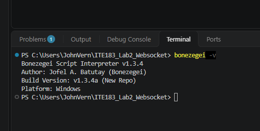
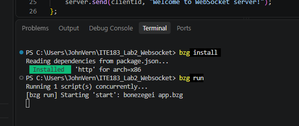
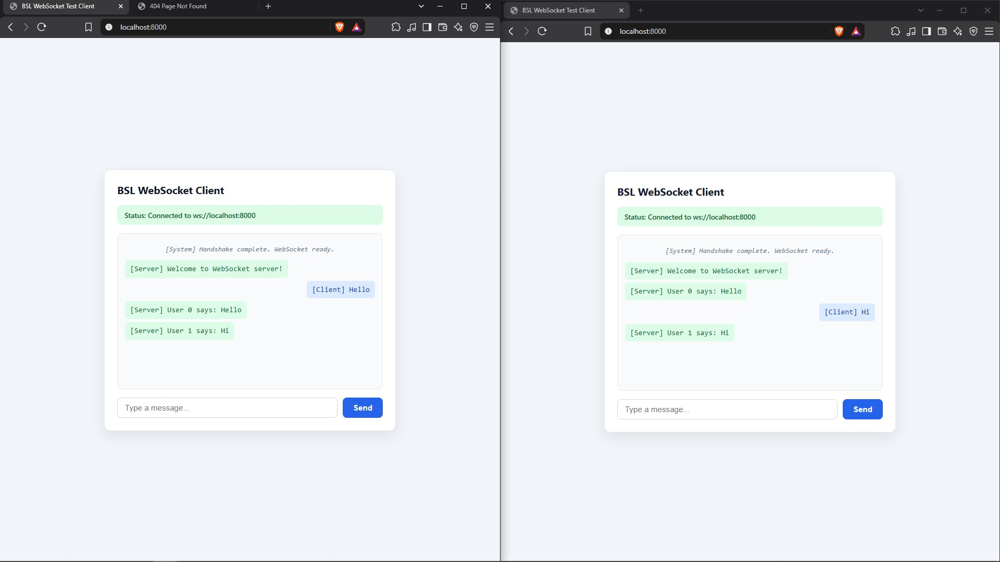
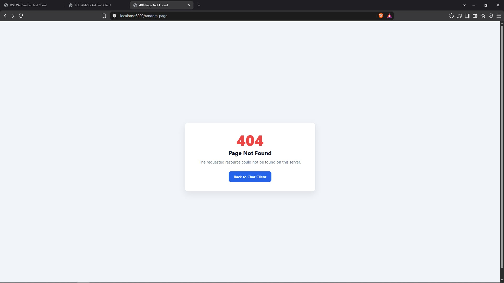

# ITE183_Lab2_Websocket

A real-time, full-duplex multi-client WebSocket chat server built using the **Bonezegei Scripting Language (BSL)**. This project demonstrates HTTP static file serving, custom 404 error routing, HTTP-to-WebSocket protocol upgrades, client connection lifecycle management, and real-time message broadcasting.

---

## 📋 Objectives

* Construct and run an event-driven WebSocket server using Bonezegei Scripting Language for full-duplex communication.
* Implement connection lifecycle handling.
* Develop real-time message broadcasting across active connections to enable multi-client interactivity and dynamic data exchange.

---

### Screenshots
All screenshot assets are located in the screenshots/ folder.

1. BZG version

2. Server startup

3.Multi-client chat window interaction

4. Error Page

